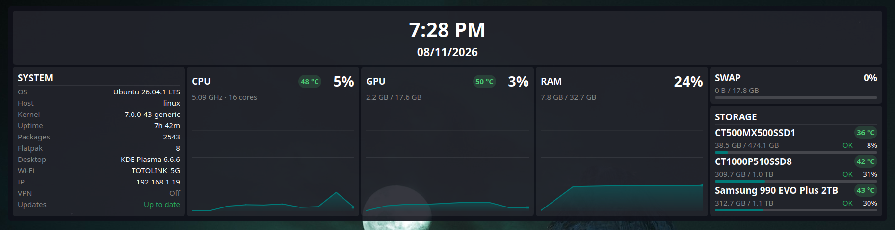
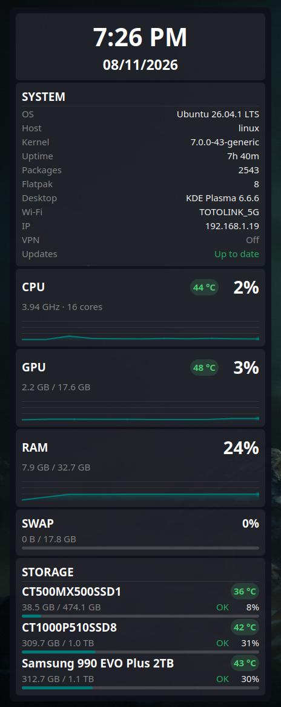
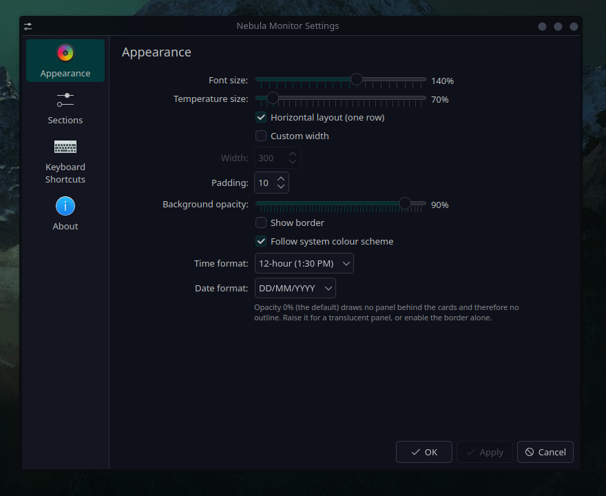

# Nebula Monitor

A borderless system dashboard widget for **KDE Plasma 6**: clock, system
information, CPU/GPU/RAM load with colour-coded temperatures, swap and SMART
storage health — with equal-card horizontal or single-column vertical layouts,
per-section visibility and a fully configurable appearance.

Horizontal layout (one row with the clock above the cards):



Vertical layout (single column):



Settings:



## Features

- **Clock** – centred time (12/24-hour) with the date (configurable format)
  underneath.
- **System** – OS, host, kernel, uptime, installed package count (with Snap and
  Flatpak listed underneath), desktop session, Wi-Fi SSID, local IP address and
  VPN connection state. Optional rows add architecture, hardware model, session
  type and pending system updates (shown last, hidden by default).
- **CPU / GPU / RAM** – load percentage, temperature badge, extra detail (CPU
  frequency and core count, VRAM, RAM split) and a 60-sample history chart.
- **Colour-coded temperatures everywhere** – green below 70 °C (safe), yellow
  from 70 °C (warm), red from 85 °C (danger); the badge size is configurable.
- **Swap** – used/total with a usage bar.
- **Storage** – every mounted drive with model name, used/total in GB/TB,
  usage percentage, SMART health and drive temperature.
- **Horizontal layout** – optional single row of cards, which scrolls only if
  the widget is narrower than the row.
- **Borderless by default** – no panel, no outline, no icons. Optionally add a
  translucent panel and/or a border.
- Fully configurable from the widget settings: font scale, temperature size,
  width, padding, vertical or horizontal layout, background opacity, border,
  whether to follow the system colour scheme, and which cards and system
  information rows are shown.

## Requirements

- KDE Plasma 6 (developed on Plasma 6.6).
- `plasma-workspace` (provides `ksystemstats` and the sensor engine).
- `udisks2` for drive health/temperature (SMART read through D-Bus, no root).
- `NetworkManager` (`nmcli`) for the Wi-Fi/VPN information.
- CPU temperature is read from hwmon (`k10temp`, `coretemp` or `zenpower`) and
  falls back to ACPI thermal zones.

## Installation

### One command (git clone)

```bash
git clone https://github.com/YOUR_GITHUB_USER/nebula-monitor.git \
    ~/.local/share/plasma/plasmoids/local.systrio && \
    systemctl --user restart plasma-plasmashell.service
```

### From the `.plasmoid` file

Download `nebula-monitor.plasmoid` and either:

- right-click the desktop → **Add Widgets…** → **Get New… / Install Widget
  From Local File…** → select the file, or
- run `kpackagetool6 --type Plasma/Applet --install nebula-monitor.plasmoid`.

### With the install script

```bash
./install.sh
```

### Manual (from a checkout)

```bash
mkdir -p ~/.local/share/plasma/plasmoids
cp -r . ~/.local/share/plasma/plasmoids/local.systrio
systemctl --user restart plasma-plasmashell.service
```

Then right-click the desktop → **Add Widgets** → search for **Nebula Monitor**.

## Configuration

Widget settings → **Appearance**:

| Setting | Default | Description |
| --- | --- | --- |
| Font size | 100 % | Scales all text and the charts (80–180 %). |
| Horizontal layout | off | All cards in one row; scrolls if the widget is narrower than the cards. |
| Custom width | off | Fixed content width (200–1200 px). |
| Padding | 14 px | Inner padding of every card and of the widget. |
| Background opacity | 0 % | 0 % = no panel and therefore no outline; raise it for a translucent panel. |
| Show border | off | Draw a 1 px outline around the content. |
| Follow system colour scheme | on | Use the Plasma colours; otherwise a built-in dark palette is used. |
| Temperature size | 70 % | Scales only the temperature badges (60–200 %). |
| Time format | 12-hour (1:30 PM) | 12-hour or 24-hour clock. |
| Date format | DD/MM/YYYY | DD/MM/YYYY, MM/DD/YYYY or YYYY-MM-DD. |

Widget settings → **Sections**:

- Show/hide the clock, system information, CPU, GPU, RAM, swap and storage.
- Show/hide individual system information rows: OS, host, kernel, uptime,
  packages, Snap, Flatpak, desktop, architecture, hardware model, session type,
  Wi-Fi/Ethernet, IP, VPN and pending updates.

Defaults keep the original look: Snap/Flatpak appear automatically under
Packages when the corresponding tool is installed, while architecture, hardware
model, session type and updates are hidden by default. Rows without data on the current machine (for
example Flatpak when it is not installed) are skipped automatically.

The outer size of a desktop widget is owned by the Plasma containment. The
widget reports its minimum size, so Plasma grows it when the font size, padding
or layout needs more room; drag the corner in *Edit Mode* to shrink it.

## Data sources

- Load, memory, swap and GPU sensors: `org.kde.ksysguard.sensors`
  (`ksystemstats`).
- CPU temperature: `contents/tools/cputemp.sh` (hwmon, because `ksystemstats`
  reports 0 on CPUs that only expose `Tctl`).
- System information, network state and storage: `contents/tools/sysinfo.sh`
  (`/etc/os-release`, `uname`, `/proc/uptime`, `dpkg`/`rpm`/`pacman`/`apk`,
  `nmcli`, `ip`, `snap`, `flatpak`, `df`, `lsblk`, UDisks2 SMART).
  Pending updates are queried from `apt`, `dnf`, `zypper` or `pacman` and
  cached for 30 minutes; every value is optional so the widget works across
  distributions and desktop setups.
- Charts hold the last 60 samples, updated once per second.

## Development

`generate-config-pages.py` regenerates both configuration pages from
`contents/config/main.xml` (the pages declare the key aliases and defaults that
Plasma expects). Run it after changing the schema:

```bash
python3 generate-config-pages.py
```

## Uninstall

```bash
kpackagetool6 --type Plasma/Applet --remove local.systrio
```

## Publishing

The package id is `local.systrio`. If you publish it under your own namespace,
change `KPlugin.Id` in `metadata.json`, the directory name, and `PACKAGE_ID` in
`install.sh`. Build the store archive with:

```bash
./package.sh
```

## License

GNU General Public License v3.0 or later (GPL-3.0-or-later) — see [LICENSE](LICENSE).

This program is free software: you can redistribute it and/or modify it under
the terms of the GNU General Public License as published by the Free Software
Foundation, either version 3 of the License, or (at your option) any later
version.
